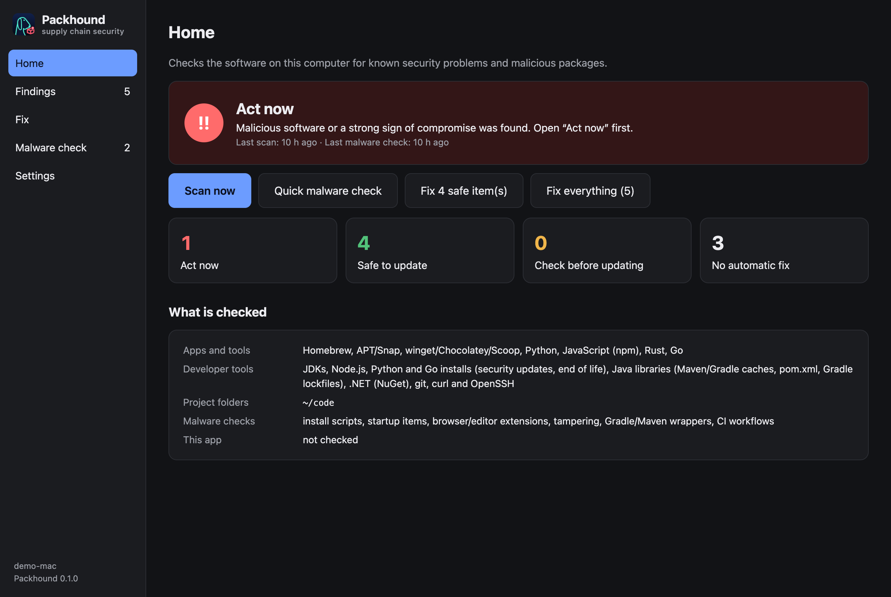
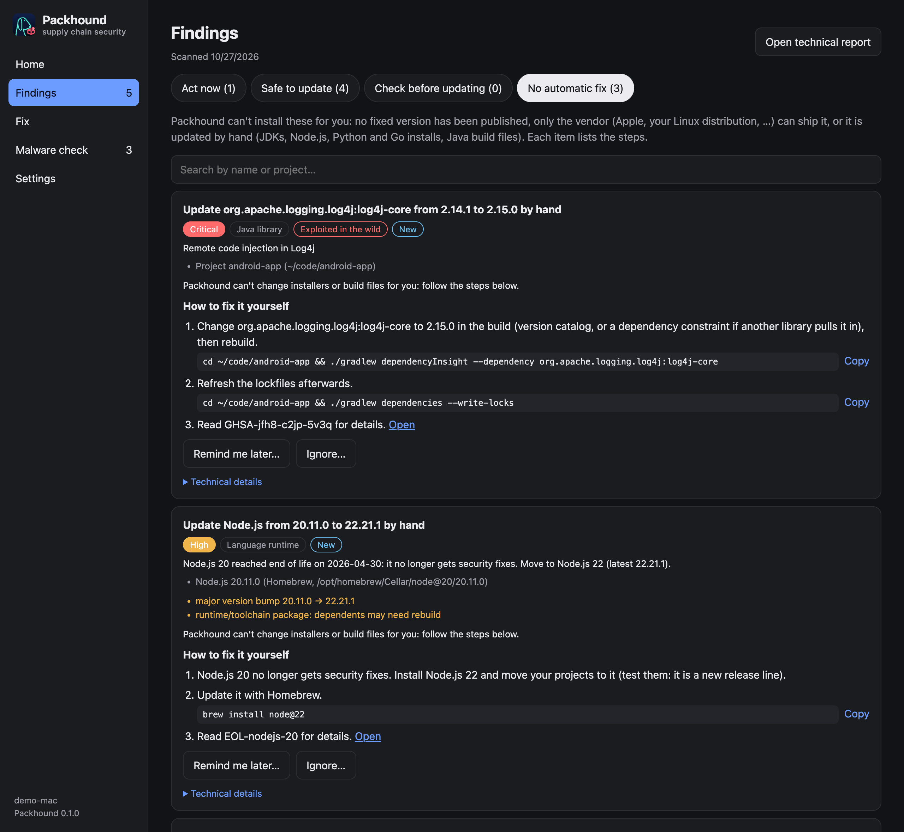
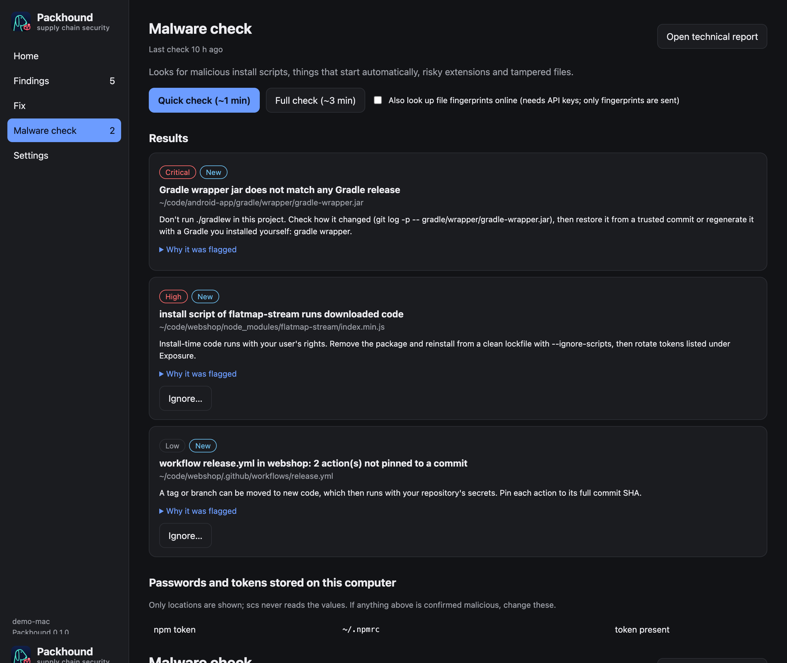

<p align="center">
  
</p>

<h1 align="center">Packhound</h1>

<p align="center"><b>Sniffs out the bad packages on your developer machine, not just in your lockfile.</b></p>

<p align="center">
  <a href="https://github.com/trinhm92/Packhound/actions/workflows/ci.yml"></a>
  <a href="https://github.com/trinhm92/Packhound/releases"></a>
  <a href="LICENSE"></a>
  
  
</p>

Packhound is a supply chain security scanner for developer machines on macOS, Ubuntu and Windows. It checks your apps, language packages, Java libraries, JDK/Node/Python/Go installs and git for known vulnerabilities and malicious packages. It also catches tampered build wrappers and risky CI workflows, and fixes what it safely can.

<p align="center"></p>

## Why Packhound

Most dependency scanners read one project's lockfile. Attacks like the npm worms of 2025 or a swapped `gradle-wrapper.jar` land on the **developer's machine**: in global tools, editor extensions, start-up items, build caches and the runtimes themselves. Packhound looks at all of it.

| | Project scanners | Packhound |
|---|---|---|
| Project lockfiles (npm, PyPI, Go, Rust, Ruby, PHP, Java, .NET) | ✅ | ✅ |
| Globally installed tools: Homebrew, APT/Snap, winget/Chocolatey/Scoop, npm -g, pipx, cargo | — | ✅ |
| Runtimes (JDK, Node.js, Python, Go): end of life, missed security updates | — | ✅ |
| Java libraries in the Maven/Gradle caches, OS-bundled git/curl/OpenSSH | — | ✅ |
| Known-malicious packages plus install scripts, start-up items, extensions | partly | ✅ |
| Gradle/Maven wrapper checksums, unpinned GitHub Actions | — | ✅ |
| Fixes with snapshot, verification and automatic rollback | — | ✅ |
| Plain-language desktop app for non-specialists | — | ✅ |

**Built to be trusted:** the scanner uses only the Python standard library, never runs the code it inventories, reads before it changes anything, and sends only package names and versions to [OSV.dev](https://osv.dev). Its own releases are built in CI from hash-locked dependencies, with [signed provenance](SECURITY.md#verifying-a-download).

## Highlights

<table>
<tr>
<td width="50%"></td>
<td width="50%"></td>
</tr>
<tr>
<td><b>Every finding says what to do.</b> Four groups (Act now, Safe to update, Check before updating, No automatic fix), and copy-paste steps for what can't be fixed automatically.</td>
<td><b>Malware and tampering checks.</b> Malicious install scripts, persistence, risky extensions, a Gradle wrapper that matches no release, CI actions not pinned to a commit.</td>
</tr>
</table>

- **Act on what matters:** exploited-in-the-wild (CISA KEV) and exploit-probability (EPSS) signals, dependency chains, toolchain conflicts.
- **Fix safely:** one click updates the low-risk items; each change is snapshotted, tested and undone automatically if a test fails. New releases wait a few days first (release-age cooldown), so a freshly hijacked version isn't installed.
- **Keep watching:** a daily schedule with desktop, Slack, Teams, webhook or email alerts, and a merged report for several machines.

## Install

**Desktop app:** download the macOS `.dmg`, Windows installer or Ubuntu `.deb` from [Releases](https://github.com/trinhm92/Packhound/releases), and check it against `SHA256SUMS` and its build provenance (see [verifying a download](SECURITY.md#verifying-a-download)).

> **The installers are not code-signed yet**, so the first launch shows a warning:
> - **macOS:** "Packhound can't be opened". Open **System Settings › Privacy & Security**, scroll down and click **Open Anyway** (once).
> - **Windows:** SmartScreen says "Windows protected your PC". Click **More info › Run anyway**.
> - **Ubuntu:** no warning; `.deb` files are installed with `sudo apt install ./scs_*_all.deb`.
>
> Verify the download first: the checksum and the signed provenance prove it was built by this repository's CI.

**Command line** (Python 3.10+, no dependencies):

```bash
pipx install git+https://github.com/trinhm92/Packhound.git
packhound scan --root ~/code     # read-only scan of this machine plus the projects under ~/code
packhound ui                     # the desktop app in your browser
```

Or from a clone: `python3 -m packhound scan`. The command is also available under its original short name, `scs`.

`scan` only reads; nothing is installed or changed. Findings land in four action groups (**Act now · Safe to update · Check before updating · No automatic fix**), each with suggested commands. See [PLAN.md](PLAN.md) for the design and roadmap, and [CONTRIBUTING.md](CONTRIBUTING.md) to get involved.

## Desktop app (for non-technical users)

```bash
packhound ui                 # opens the app (native window if pywebview is installed, otherwise your browser)
packhound ui --browser       # always use the browser
pip install -r requirements-gui.txt   # optional: native window (pywebview, pinned)
```

The app covers the whole workflow in plain language:
- **Home:** a health status ("Looking good / Updates recommended / Needs attention / Act now"), with **Scan now**, **Quick malware check** and **Fix safe items** buttons.
- **Findings:** grouped as *Act now*, *Safe to update*, *Check before updating* and *No automatic fix*. Each item says what to do ("Update requests from 2.19.0 to 2.20.0") and where it is ("Project api", "Python 3.10 (pyenv)"), with *Update this*, *Remind me in 2 weeks* and *Ignore…* buttons. Ignoring needs a reason and an expiry, and malicious items can't be ignored. Advisories, dependency chains and CLI commands are under *Technical details*.
- **Fix:**
  - **Fix safe items** updates everything that's low-risk, using the same snapshot, verify and automatic-undo engine as `scs patch`. Risky groups are skipped.
  - **Fix everything** also fixes the *Check before updating* items. Each group is still snapshotted, tested and undone automatically if a test fails. An optional tick box also moves Python environments whose fixes need a newer Python (see "How each kind of item gets fixed").
  - Or pick items, review the grouped changes (*low risk* / *needs care*, with the toolchain notes) and apply. Groups that need care require an explicit confirmation.
  - System-package updates on Linux ask for your password in a graphical prompt.
- **Malware check:** quick or full check, optional online fingerprint lookups, results in plain language, a one-click **Quarantine** (restorable), and the list of stored credentials to rotate.
- **Settings:** project folders (native folder picker), automatic daily checks (with a preview of exactly what gets installed), and notification channels with a test button.

**Security of the local app.** It listens on `127.0.0.1` only, with a random per-launch token required on every API call. The Host header is checked to block DNS rebinding, and there are no CORS headers. The CSP is strict (`script-src 'self'`, no inline code), and all scan data is HTML-escaped. It only quarantines items the malware check reported, and only opens https links in the system browser.

### Building installers

| Platform | Command | Output |
|---|---|---|
| macOS | `packaging/build_macos.sh` | **Universal** `Packhound.app` + `.dmg` (Intel and Apple Silicon, macOS 11+). It needs a universal2 Python: python.org's installer, used automatically from `/Library/Frameworks` (override with `PYTHON=`). The script checks that every binary in the bundle has both architectures. `SCS_TARGET_ARCH=arm64` or `x86_64` builds a single architecture. Set `CODESIGN_IDENTITY` and `NOTARY_PROFILE` to sign and notarize (needs an Apple Developer account). |
| Windows | `packaging\build_windows.ps1` | App folder + `.zip`, and a per-user installer if Inno Setup is installed. Set `SIGN_CERT_THUMBPRINT` to sign. |
| Ubuntu/Debian | `packaging/build_linux.sh` | `scs_<version>_all.deb` with a desktop entry. It uses the system Python and GTK WebKit, so nothing is bundled. |

Build dependencies are hash-locked: see [Security of scs itself](#security-of-scs-itself). Each build also records exactly what it bundled in `build-requirements.lock.txt`. Unsigned builds work, but they warn on first launch. On macOS 15+, open **System Settings › Privacy & Security › Open Anyway** (right-click › Open no longer bypasses Gatekeeper). On Windows, click **More info › Run anyway** in SmartScreen.

### CI: tests and installers on all three OSes

`.github/workflows/ci.yml` runs on every push and pull request:

1. **Tests** on Ubuntu 24.04, macOS 15 and Windows 2025 with Python 3.10 and 3.13, plus a CLI smoke test.
2. **Builds:**
   - the universal2 macOS `.dmg`;
   - the Windows zip and installer;
   - the Ubuntu `.deb`.

   Each installer is smoke-tested on a real machine. The app runs a headless `--watch` on both macOS architectures and on Windows, and the `.deb` is installed and its UI server probed.
3. **Release:** on a tag `v*`, all installers plus `SHA256SUMS` go into a **draft** GitHub release for you to review. Each file gets a signed build-provenance attestation, which anyone can check with `gh attestation verify <file> --repo trinhm92/Packhound` (see [SECURITY.md](SECURITY.md#verifying-a-download)).

```bash
git tag v0.1.0 && git push origin main v0.1.0
```

**Supply-chain hygiene in the pipeline:**
- every action is pinned to a full commit SHA;
- the token is read-only (write access only in the release job);
- there is no `pull_request_target`, and checkout doesn't keep credentials;
- python.org's installer is verified by SHA-256 and PSF signature before it's installed;
- Dependabot updates pins with a 14-day cooldown.

**Optional signing secrets.** Without them, the builds are unsigned.

| Secret | Purpose |
|---|---|
| `MACOS_CERT_P12`, `MACOS_CERT_PASSWORD`, `MACOS_SIGN_IDENTITY` | Developer ID Application certificate (base64 .p12) and its name |
| `APPLE_ID`, `APPLE_TEAM_ID`, `APPLE_APP_PASSWORD` | notarization (app-specific password) |
| `WINDOWS_CERT_PFX`, `WINDOWS_CERT_PASSWORD` | Authenticode certificate (base64 .pfx) |

## Workflow

```
scs scan  →  scs triage  →  scs plan  →  (review, run target by target)  →  scs scan again
```

```bash
packhound scan --root ~/RnD                 # system packages + projects under ~/RnD
packhound triage                            # decide per finding: patch now / verify first / defer / ignore
packhound plan                              # dry-run patch plan (.md + guarded .sh + .json)
```

**Other commands:**

```bash
packhound scan --root ~/RnD --nvd           # also match Homebrew formulae against NVD (slow, low confidence)
packhound scan --offline                    # cached data only, nothing sent over the network
packhound scan --fail-on high --format ''   # CI / cron: exit 2 on HIGH+ findings
packhound triage --bucket respond --bucket patch   # triage only some buckets
packhound triage --auto                     # accept suggested actions (never ignores or defers)
packhound plan --suggested                  # include untriaged findings using their suggested bucket
packhound ignore GHSA-xxxx --package npm:qs --reason "dev-only, not reachable" --expires 60d
packhound policy [--prune]                  # list ignore rules / drop expired ones
packhound report                            # re-render the latest scan
packhound history                           # past scans
packhound collectors                        # which collectors apply on this machine
```

### What triage and plan add (Phase 2)

- **Chain of effect.** A dependency graph is built for every lockfile, Python environment and Homebrew. Each finding shows the shortest paths from your direct dependencies, e.g. `flask@2.2.2 › jinja2@3.1.2`, and which direct dependencies pull it in. Go uses `go mod graph` from the local module cache only, with no network access and no toolchain download.
- **Toolchain checks.** For each fixed version, scs asks the registry (PyPI, npm, crates.io, Go proxy, RubyGems, Packagist) which runtime it needs. It compares that with what the project declares or the environment runs: `.python-version`, `requires-python`, `.nvmrc`, `engines`, `.tool-versions`, `go.mod` go/toolchain, `rust-toolchain`, `rust-version`, the Gemfile `ruby` line, composer `php`. Any conflict moves the finding to **Verify first** with the reason. Example: "0.56.0 needs go >=1.26.0, but myservice uses go 1.25.5".
- **Range conflicts.** A direct dependency whose declared range in `package.json` or `pyproject.toml` excludes the fix is flagged, and the plan uses `npm install x@^fix` instead of `npm update`.
- **Ignore policy.** Every ignore rule needs a reason, expires after 90 days by default, and is never applied to malicious packages unless it says `"force": true`. Rules live in `~/.config/scs/policy.json` (personal) or `./scs-policy.json` (commit it for a team). A path-scoped rule only hides a finding when every location matches.
- **Decisions.** Saved in `~/.local/share/scs/decisions.json`. A deferral comes back when it expires, and a decision is marked stale when new advisories appear for that package.
- **Plan.** Groups the fixes by target: Homebrew, each Python env, each global npm prefix, each project. For each target it lists backup steps (pip freeze, lockfile copy or a git branch), consolidated upgrade commands, verification (`pip check`, `npm ls`, the project's build/test/lint scripts, `go build/vet/test`, `cargo test`…) and rollback. It also:
  - updates transitive npm dependencies within their declared ranges first, and suggests overrides only as a fallback;
  - warns about Apple/OS-managed and PEP 668 interpreters;
  - knows that npm inside Homebrew is upgraded with `brew upgrade node`.

  The `.sh` file refuses to run unless you pass `SCS_CONFIRM=1` and name the targets: `SCS_CONFIRM=1 bash plan.sh target_2`.

Or install it as a command with `pip install -e .`, then run `scs scan ...`. The tool has no third-party dependencies.

The HTML and JSON reports go to `~/.local/share/scs/reports/` by default. Use `--out DIR` to change that.

## Windows (Phase 6)

Run it the same way with the Python from python.org or the Microsoft Store (`py -m scs scan --root C:\work`). It still uses only the standard library; `winreg` covers the registry.

- **Inventory.**
  - Installed programs come from the registry Uninstall keys (HKLM, WOW6432Node and HKCU).
  - winget is read via `winget list` / `winget upgrade`, Chocolatey via `choco list` / `outdated`, and Scoop is read straight from `~/scoop`, including bucket updates.
  - Python and Node globals are found in their Windows locations.
  - None of these have an OSV feed. Pending updates appear in the outdated list, and common tools (Git, Python, Node.js, 7-Zip, PuTTY, Chrome, Firefox…) are matched against NVD with `--nvd`.
- **Plan and patch.** `scs plan --outdated` adds updates for these managers:
  - **Scoop:** `scoop update`, rolled back exactly with `scoop reset app@old`.
  - **winget:** `winget upgrade --id`, with a best-effort rollback that reinstalls the old version.
  - **Chocolatey:** `choco upgrade`. This needs an elevated terminal, and scs checks for that.

  Plans built on Windows use cmd.exe syntax (`cd /d`, `"…"` quoting, `%BACKUP%`) and write a guarded `plan-*.cmd`. `scs patch` runs commands through `cmd /c`.
- **Malware checks.**
  - Run/RunOnce keys, Startup folders, auto-start services (resolving `svchost` to its ServiceDll and flagging unquoted service paths), scheduled tasks outside `\Microsoft\`, and WMI event consumers.
  - IFEO debugger hijacks, AppInit_DLLs, and changes to Winlogon Shell/Userinit.
  - PowerShell profiles, diffed against the baseline like shell rc files.
  - Rules for encoded PowerShell and LOLBin download cradles (`mshta`, `certutil -urlcache`, `regsvr32 /i:http`, `IEX (New-Object Net.WebClient)…`).
  - Authenticode via PowerShell for every autostart target and installed program. It flags files that are unsigned or modified after signing, and **signer changes since the last scan**.
  - The exposure check adds the Windows gh/npm token locations, saved RDP passwords and the PSReadLine history.

## Continuous monitoring (Phase 7)

```bash
packhound schedule print --daily 09:00 --root ~/RnD    # preview the LaunchAgent / systemd timer / scheduled task
packhound schedule install --daily 09:00 --root ~/RnD  # install it (status | remove)
packhound watch --root ~/RnD                           # what the schedule runs; exit 2 when it alerts
packhound watch --test-alert                           # check your notification channels
packhound alerts                                       # recent alerts
packhound malware --reputation                         # opt-in hash reputation for one malware run
```

- **`scs watch`.** Each run does a vulnerability scan plus a quick malware check (install-time code, persistence, extensions; `--malware full|none`). It alerts on:
  - **new** findings at or above `--min-severity` (default high);
  - **any** malicious package, IOC file or known-exploited (KEV) CVE;
  - malware findings that were not there in the previous run.

  Each item alerts once; the state is kept in `~/.local/share/scs/alerts.json`. The first run only records a baseline and alerts on malicious, IOC and KEV items, so existing issues don't flood you.
- **Notifications.** Configure them in `~/.config/scs/config.json`. Keep secrets in environment variables with `env:NAME`:
  ```json
  {"notify": {"desktop": true,
              "slack_webhook": "env:SCS_SLACK_WEBHOOK",
              "teams_webhook": "env:SCS_TEAMS_WEBHOOK",
              "webhook": "env:SCS_WEBHOOK",
              "email": {"host": "smtp.example.com", "port": 587, "username": "me@example.com",
                        "password": "env:SCS_SMTP_PASSWORD", "from": "scs@example.com", "to": ["me@example.com"]}},
   "alert_min_severity": "high"}
  ```
  - Desktop notifications use `osascript` on macOS, `notify-send` on Linux and a tray balloon on Windows.
  - Webhooks must be https.
  - Teams receives an Adaptive Card, the format Teams Workflows webhooks expect.
  - Alerts contain package names, advisory ids, the host name and local report paths, never secret values.
- **Scheduling.**
  - macOS: a LaunchAgent `com.scs.watch` (background priority, logs in `~/.local/share/scs/logs`).
  - Linux: a systemd user timer `scs-watch.timer` with `Persistent=true`, so a run missed while asleep happens at the next boot. `schedule print` shows a crontab line for machines without systemd.
  - Windows: a Task Scheduler task `\scs\watch`.

  The persistence audit recognises this job as scs's own; a look-alike with a different name is still flagged.
- **Hash reputation** (opt-in with `--reputation`, `scs watch --reputation`, or the `reputation` config). It sends **SHA-256 hashes only** of install-hook files, `.pth` files, autostart programs, executables in `~/Downloads` and any `--path`:
  - **MalwareBazaar:** free abuse.ch Auth-Key in `ABUSECH_AUTH_KEY`. A known sample is reported as critical.
  - **VirusTotal:** API key in `VT_API_KEY`. It's only asked about files MalwareBazaar doesn't know, rate-limited to the free tier's 4 per minute, and capped at 20 per run (`virustotal_limit`). 3+ detections are high, 10+ critical, 1–2 medium (often false positives).

  Results are cached: 7 days for hits, 1 day for misses.

## Several machines: fleet report (Phase 6)

```bash
# on each machine (macOS, Ubuntu, Windows), after `scs scan` and optionally `scs malware`
packhound export --out "$(hostname).json"
# or collect over SSH
ssh build-01 'cd ~/scs && packhound scan --format "" >/dev/null && packhound export' > build-01.json

packhound merge --dir ./bundles             # fleet HTML + JSON; exit 2 if any host has a respond-now item
```

Bundles contain findings, summaries, malware results and exposure *locations*. The full package inventory stays on the machine, and home-directory paths become `~`. The fleet report shows:
- each host's buckets, scan age, malware hits and exposure, including unencrypted SSH keys;
- the **most widespread vulnerable packages** (hosts × risk);
- CVEs across hosts, with known-exploited ones first;
- respond-now items, with a warning when the **same indicator appears on several hosts**;
- medium-and-above malware findings, grouped across hosts.

## Ubuntu / Debian (Phase 5)

The same commands work on Ubuntu and Debian, including derivatives such as Mint and Pop!_OS, which map to their Ubuntu base. On top of the cross-platform collectors:

- **APT packages.** scs reads `/var/lib/dpkg/status` directly, groups packages by **source package** (the way USN/DSA advisories are keyed) and queries OSV for the **exact release**, e.g. `Ubuntu:24.04:LTS` or `Debian:12`, so a fix for another release is never suggested. Versions are compared with dpkg's own rules: epochs, `~`, `+dfsg`, `ubuntu3.10 > ubuntu3.9`.
  - Fixes available only through Ubuntu Pro (ESM) are flagged (`sudo pro attach`).
  - The kernel, glibc, openssl, systemd, sudo and similar go to **Verify first** with a "reboot / restart services" reason.
  - Chains of effect come from `Depends`, e.g. `curl › openssl`.
- **Snap and Flatpak.** These are inventoried, and pending refreshes appear in the outdated list. No public CVE feed exists for them.
- **Plan and patch.** APT targets run `apt-get update` followed by `apt-get install --only-upgrade <binaries>`. Verification checks `dpkg --audit`, `apt-get check` and that no systemd unit has newly failed. `scs patch` needs **`--allow-sudo`** for these targets: it asks for your password once, then runs every command as `sudo -n`, so nothing can hang on a hidden prompt. Rollback is best-effort: it downgrades to the recorded versions while the old `.deb`s are still available, so APT targets also need `--accept-risk`.
- **PEP 668.** System Python installs in `/usr/local` and `~/.local` are recognised as externally managed. Those pip steps are skipped with advice to use apt, a venv or pipx.
- **Malware checks.** On Linux, `scs malware` also runs:
  - `dpkg --verify` for system binaries and libraries that differ from their packages (config files excluded);
  - checks for `/etc/ld.so.preload` (a rootkit hook), system rc files and `/etc/profile.d` (diffed against the baseline), and `rc.local`;
  - checks for systemd units and timers in `/etc` and the user's directories;
  - a search for setuid binaries in temp, home and opt directories.

  On both platforms it also flags **SSH authorized keys added since the last scan**.

## Applying fixes (Phase 4)

```bash
packhound patch                             # list the plan's targets
packhound patch --all --dry-run             # preflight every target, change nothing
packhound patch --target 2                  # apply one target (asks before running)
packhound patch --target 2 --target 5 --yes # no prompts for targets without risks
packhound patch --all --yes --accept-risk --keep-going
packhound verify --target 7                 # run just the verification commands
packhound patch --history                   # previous runs
```

For each target, `scs patch` does the following:

1. **Preflight.** It refuses to proceed when:
   - a command uses `sudo`;
   - a required tool is missing;
   - the installed versions no longer match the plan (stale);
   - the project has uncommitted lockfile or manifest changes (`--allow-dirty` overrides this).

   Targets with toolchain warnings, no verification, or no rollback (Homebrew) need `--accept-risk` or an interactive "y".
2. **Baseline verification.** It runs the verify commands *before* changing anything. A check that already failed is not held against the update.
3. **Snapshot.** It takes an exact, offline snapshot:
   - manifests and lockfiles are copied;
   - `node_modules`, `.venv`, site-packages and global tool directories are cloned. APFS clones are copy-on-write, so this is fast even for large trees.
4. **Apply.** It runs the plan's commands. Each one is logged, `stdin` is closed and a timeout applies. `--ignore-scripts` keeps npm/yarn/pnpm install scripts from running.
5. **Verify.** A check that passed before and fails now is a regression.
6. **Post-check.** It re-runs the malware rules on the updated packages' install-time code, and confirms the vulnerable versions are actually gone. If one is still present, the target is marked `partial`.
7. **Rollback.** It rolls back automatically when an apply command fails, verification regresses or the post-check finds malware. The snapshot is restored and verification runs again. The failed state is kept in the run's `backups/…/failed-state`, never deleted.

Every step is written to `~/.local/share/scs/runs/<id>/journal.json`, with a log per command. The run stops after a rollback unless you pass `--keep-going`. Ctrl+C rolls back the target in progress.

### How each kind of item gets fixed

| Situation | What scs does | Undo |
|---|---|---|
| Direct install (pip env, npm -g, brew, apt, winget, choco, scoop, snap, cargo) | upgrades with that package manager | snapshot (pip, npm, cargo), plan rollback (winget, choco, scoop, snap), best-effort (apt), none (brew) |
| Transitive Python package whose parent pins an old version | upgrades the package; if `pip check` then reports a conflict, also upgrades the parent that pins it | site-packages snapshot |
| Package bundled inside a global npm tool (npm bundles undici, firebase-tools pins uuid) | updates the tool if a release that runs on your Node ships the fix; otherwise `scs fixer npm-nested` replaces the copies inside the tool. Downloads are checked against the registry's sha512, missing dependencies are installed next to the new copy, native packages are rebuilt, and the copy and its users are load-tested before and after. A major-version jump counts as "needs care". Reinstalling the tool undoes the patch, so scan again after tool updates | the tool's folder snapshot |
| Homebrew / Debian / Ubuntu Python marked "externally managed" (PEP 668) | pip with `--break-system-packages`, only for add-on packages in that Python's site-packages (apt-owned `dist-packages` are left to APT) | site-packages snapshot |
| Folder owned by root (Linux `/usr/lib/node_modules`, `/usr/local/lib/python3*/dist-packages`) | the same commands through `sudo` (one graphical password prompt in the app) | snapshot, restored with `sudo` |
| Windows machine-wide software (Chocolatey, `C:\Program Files\…`) | runs the step in an Administrator process (one UAC prompt per step). winget runs unattended with `--accept-source-agreements --accept-package-agreements`; programs that winget doesn't manage are updated by name through winget | plan rollback where the manager supports it |
| Fix needs a newer Python than the environment has (e.g. pillow 13 needs 3.11) | opt-in (`scs plan --migrate`, or the tick box in the app). `scs fixer py-migrate` installs the newest patch release of the needed Python with pyenv/pyenv-win, reinstalls the env's top-level packages there, switches `pyenv global` if it pointed at the old one, and moves the old environment into the run's backups. A macOS user site (`~/Library/Python/3.9`) moves into your pyenv Python | the old environment is moved back and `pyenv global` restored |
| File shipped by the OS vendor (Apple's Command Line Tools Python, apt-owned Python) | not changed: listed under *No fix yet* with the reason, until the vendor ships an update | — |
| No fixed version published | listed under *No fix yet*; scs keeps checking | — |

## Malware / compromise checks (Phase 3)

```bash
packhound malware --root ~/RnD              # all checks (~2–3 min; signatures and pip hashing dominate)
packhound malware --only persistence,extensions,exposure   # quick daily check (~10 s)
packhound malware --fail-on high --format ''               # cron/CI: exit 2 on high+
packhound quarantine <path> --reason "..."  # move aside (never deletes), strips exec bits
packhound quarantine --list | --restore <id>
```

| Check | What it looks at |
|---|---|
| `packages` | npm `preinstall`/`install`/`postinstall` scripts and the files they run, in global and project `node_modules`. Python `.pth` start-up lines and `sitecustomize.py`. IOC file names such as Shai-Hulud 2.0's `setup_bun.js`. IOC files in your repos. |
| `integrity` | pip `RECORD` sha256 versus installed files (`--integrity code` by default, or `full`). `node_modules` contents versus `package-lock.json` (drift and extraneous packages). |
| `buildchain` | What runs when a project is built. `gradle-wrapper.jar` must match a checksum Gradle published for a release, and `maven-wrapper.jar` the jar on Maven Central. Wrapper properties that download Gradle/Maven over HTTP, from another host, or without `distributionSha256Sum`. `gradlew`/`mvnw` scanned like CI files. GitHub Actions not pinned to a full commit SHA, and `pull_request_target` workflows that check out the pull request's code. GitLab CI `include:` from a URL or from a project without a fixed ref. |
| `signatures` | `codesign` and Gatekeeper for every app. Also flags an app whose **signing team changed** since the last scan, which can mean a hijacked update. |
| `persistence` | LaunchAgents/Daemons (target signature, temp/hidden locations, inline scripts), cron, login hooks, shell rc files (with **lines added since the last scan**), git hooks including `core.hooksPath`, and GitHub workflows (secrets dumps, exfil endpoints, **untracked** workflow files). |
| `extensions` | VS Code, Cursor and Windsurf extensions (sideloaded VSIX, IOC IDs). Chrome, Brave, Edge, Arc and Chromium extensions (not from a web store, powerful permissions, IOC IDs). |
| `engines` | Optional. YARA (bundled `scs/rules/*.yar` plus `~/.config/scs/yara/`, e.g. the YARA Forge core set), ClamAV and GuardDog. They scan install-hook packages, `.pth` files, autostart programs, `~/Downloads` and `--path`. Each engine is used only if it is installed. |
| `exposure` | Where credentials live: npm, PyPI, AWS, GCP, Azure, kube, Docker, gh, git-credentials, SSH keys (**unencrypted or passphrase-protected**), `.env` files, and tokens typed into shell history. It reports **locations and kinds only**, never values, with how to rotate each. |

The behaviour rules are heuristics that run only on code that executes implicitly. Treat a result as "suspicious, take a look", not as proof. The first run records a baseline in `~/.local/share/scs/malware-baseline.json`. Later runs flag new autostart items, extensions, git hooks and workflows, plus new shell rc lines.

## What it covers (Phase 1)

| Collector | Source |
|---|---|
| `brew` | Homebrew formulae and casks: reverse dependencies ("needed by") and outdated status |
| `pip` | site-packages for pyenv, Homebrew, python.org, Command Line Tools, conda, pipx, uv tools and every venv under `--root` |
| `npm-global` | Global node_modules for npm, nvm, volta, fnm, pnpm and bun, with the parent chain |
| `cargo` | `cargo install` binaries |
| `lockfile` | package-lock, npm-shrinkwrap, yarn.lock, pnpm-lock, poetry.lock, uv.lock, Pipfile.lock, requirements*.txt, Cargo.lock, go.mod, Gemfile.lock, composer.lock, pom.xml, gradle.lockfile, gradle/libs.versions.toml, NuGet packages.lock.json |
| `java-cache` | Java libraries every Maven/Gradle build on this machine downloaded (`~/.m2/repository`, `~/.gradle/caches/modules-2`). Only versions with a downloaded `.jar`/`.aar` count. |
| `runtimes` | JDKs (macOS JavaVirtualMachines, SDKMAN, Homebrew, Android Studio/IntelliJ, Gradle toolchains, Windows vendors), Node.js (Homebrew, nvm, Volta, fnm), Python (pyenv, uv, Homebrew, python.org, Command Line Tools) and Go toolchains. Each is checked for end of life and missed security updates (endoflife.date; nodejs.org's security-release flags), and Go's standard library against OSV. |
| `devtools` | git, curl and OpenSSH that Apple (Command Line Tools, Xcode, macOS) or Windows ship, matched against NVD. Homebrew, APT and winget copies come from those collectors; their git/curl/OpenSSH are matched against NVD without `--nvd` too. |

JDKs, Node.js/Python/Go installs, OS-bundled tools, the Java caches and pom.xml/Gradle/NuGet files are updated by installers, IDEs or by editing build files. Their findings go to **No automatic fix** with step-by-step instructions; scs never runs those steps itself.

The collectors read metadata files and **never start the packages they inventory or anything that loads them**, so a malicious `.pth` file or install hook can't run during a scan. The only programs a scan starts are version calls: `git`/`curl --version` and `ssh -V` for Apple's or Windows' own copies, and `python -I -S -V` or `node --version` for a runtime whose version isn't written in a file.

**Data sources:**
- [OSV.dev](https://osv.dev): advisories, plus `MAL-*` and CWE-506 malware reports
- CISA KEV: vulnerabilities known to be exploited
- FIRST EPSS: exploit probability
- NVD: git, curl and OpenSSH by default; every Homebrew formula / Windows program with `--nvd`
- endoflife.date and nodejs.org/dist/index.json: runtime release lines, end-of-life dates and security releases
- services.gradle.org and repo.maven.apache.org: wrapper checksums (public release data only)
- Bundled **IOC packs** in `scs/iocs/`

Add your own IOC packs to `~/.config/scs/iocs/*.json` or pass `--ioc-dir`.

**Privacy:** online scans send package names and versions to api.osv.dev. Private package names in your lockfiles are included. Use `--offline` to use only data cached from earlier scans.

## Security of scs itself

scs runs package managers with administrator rights, so it is a target in its own right. These safeguards are built in:

| Risk | Safeguard |
|---|---|
| A fix installs a hijacked release published hours ago | **Release-age cooldown.** Fixes from PyPI and npm use the newest version that has been public for at least `fix_min_age_days` (default 7; 2 when the problem is being exploited, per CISA KEV). The package managers get the same cutoff for dependencies: pip ≥ 26 `--uploaded-prior-to`, npm `--before`, and the nested npm patcher filters every version it fetches. After a pip change, `scs fixer age-check` rejects anything that still arrived too new, and the change is rolled back. A fix that only exists in a too-new release waits, and the plan says until when. Set it in **Settings › Safety**, or with `scs plan --min-age N` (0 = off). Homebrew, APT, winget and Chocolatey packages are reviewed by their maintainers and are not held back; yarn/pnpm projects get a note on how to set their own age gate. |
| A compromised build dependency ends up inside the app | **Hash-locked builds.** `packaging/lock_build_deps.py` resolves the build dependencies per platform from PyPI metadata (using the same cooldown) and records the SHA-256 of every file in `packaging/locks/`. The build scripts install with `pip --require-hashes --no-deps`, so they can use only those exact files. Source-only packages are built with the locked setuptools, not one fetched during the build. pip isn't upgraded during the build. |
| A malicious or vulnerable package in the build environment | **`scs fixer build-check`** runs before packaging: it looks up every package of the build venv in OSV and checks its site-packages for startup hooks. Malicious packages always stop the build; vulnerable ones do too unless `SCS_ALLOW_VULNERABLE=1` is set after review. |
| The installed app is modified later | **`scs self-check`**, the Home page and every scheduled run check the app. On macOS it uses `codesign --verify --deep --strict`. On Windows it uses a SHA-256 manifest written at build time, plus Authenticode when signed. For the .deb it uses `dpkg --verify scs`, with md5sums shipped in the package. A failure is a critical alert. |
| Someone swaps the download and its checksum | Set `SCS_SIGN_KEY` to an SSH key when building, and the `.sha256` file is signed (`ssh-keygen -Y sign`, namespace `scs-release`). Publish your public key somewhere other than the download page. For full trust, sign the app itself: `CODESIGN_IDENTITY` + `NOTARY_PROFILE` on macOS, `SIGN_CERT_THUMBPRINT` on Windows. |

To update the build dependencies, run `python3 packaging/lock_build_deps.py`, review the diff of `packaging/locks/`, and rebuild.

What is still up to you: an unsigned app proves only that it hasn't changed since it was built, not who built it. And everything is only as trustworthy as the machine that builds it.

## Config

Settings come from `~/.config/scs/config.json` or `./scs.json`, and CLI flags override them:

```json
{ "roots": ["~/RnD"], "max_depth": 7, "nvd": false, "ioc_dirs": [], "fix_min_age_days": 7 }
```

`./scs.json` is read from the folder you run scs in; this repository's `.gitignore` excludes it so local settings are never committed. Keep secrets (webhooks, SMTP passwords) out of either file: write `env:NAME` and set the environment variable instead.

`NVD_API_KEY` in the environment makes `--nvd` about 10× faster.

## Tests

```bash
python3 -m unittest discover -s tests
```
